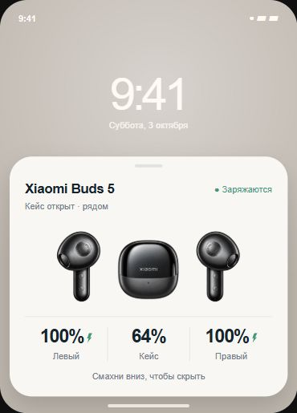

# Xiaomi Buds 5 Overlay

Откройте кейс Xiaomi Buds 5, чтобы увидеть заряд левого наушника, кейса и правого наушника поверх текущего экрана. Это неофициальное приложение для **Android 12 и новее**. Версия 0.7.1 тестовая. Проверена связка Xiaomi Buds 5 и POCO F7 с Android 16 / HyperOS 3.

**[Скачать тестовый APK](https://github.com/cveloy102/buds-curtain/releases/download/v0.7.1/XiaomiBuds5Overlay-0.7.1.apk)** · [Инструкция](docs/usage.md) · [Страница приложения](https://cveloy102.github.io/buds-curtain/)

## Начало работы

1. Установите APK и подключите наушники к телефону по Bluetooth.
2. Разрешите **«Устройства поблизости»** и **«Показ поверх других приложений»**. Выберите сопряжённые Xiaomi Buds 5 и нажмите **«Запустить наблюдение»**.
3. При включённом экране откройте кейс с обоими наушниками внутри. Дождитесь карточки с тремя показателями заряда.

<picture>
  <source media="(prefers-color-scheme: dark)" srcset="landing/assets/stand-dark.jpg">
  
</picture>

*Пример карточки из дизайн-стенда. Проценты на снимке демонстрационные.*

**Если карточка не появилась** — [проверьте разрешения, фоновую работу и автозапуск HyperOS](docs/usage.md#если-карточка-не-появляется) или [сообщите об ошибке](https://github.com/cveloy102/buds-curtain/issues/new).

## Карточка наушников

На [сайте проекта](https://cveloy102.github.io/buds-curtain/#preview) можно посмотреть скриншоты тёмной и светлой карточки из дизайн-стенда. Значения заряда на стенде даны для примера. В приложении доступны светлая, тёмная и системная темы; проверенный порядок заряда — **левый → кейс → правый**.

## Возможности

- Автоматическое обнаружение единственных сопряжённых Xiaomi Buds 5 или ручной выбор устройства.
- Отображение трёх значений заряда по свежим Fast Pair-сигналам.
- Показ, когда получено подтверждение обоих наушников в кейсе; скрытие при извлечении, закрытии, потере сигнала или отключении Bluetooth.
- Карточка следует за пальцем: короткий свайп возвращает её, длинный скрывает до следующего открытия.
- Светлая, тёмная и системная темы для экрана приложения и карточки.
- Фоновое наблюдение, восстановление BLE-сканирования и локальная диагностика.
- Демонстрационный показ карточки для проверки внешнего вида.

Если свежих данных нет, вместо заряда отображается `—`. Демонстрационные значения явно отмечены как пример.

## Как определяется состояние

Карточка использует рекламные Bluetooth-пакеты, а не отдельный датчик крышки. Подтверждения левого и правого наушника объединяются в пределах шести секунд. Известный заряд кейса и признаки зарядки обоих наушников помогают исключить повторные показы при использовании одного наушника.

## Совместимость и данные

Проверено на **Xiaomi Buds 5 + POCO F7, Android 16 / HyperOS 3**. Поддержка других моделей наушников не заявлена. На заблокированном экране новое окно не показывается. Задержка зависит от поступления BLE-сигналов; энергосбережение может ограничивать фоновое наблюдение.

Данные обрабатываются локально. Расширенный журнал содержит Bluetooth-адреса; включайте его для диагностики и проверяйте перед передачей. Наблюдение можно остановить в приложении. Подробнее: [данные и разрешения](docs/PRIVACY.md).

Для разработчиков: [сборка и выпуск](docs/DEVELOPMENT.md) · [участие в проекте](CONTRIBUTING.md) · [безопасность](SECURITY.md).

## В версии 0.7.1

По умолчанию используется «Стандартная» карточка. Стиль «Витрина» с мягкой подсветкой и сегментными шкалами заряда можно выбрать в **«Внешний вид» → «Стиль карточки»**.

Подробнее: [CHANGELOG](CHANGELOG.md). Результаты проверок: [OBSERVATIONS](OBSERVATIONS.md).

[Каталог приложений](https://cveloy102.github.io/#buds)
