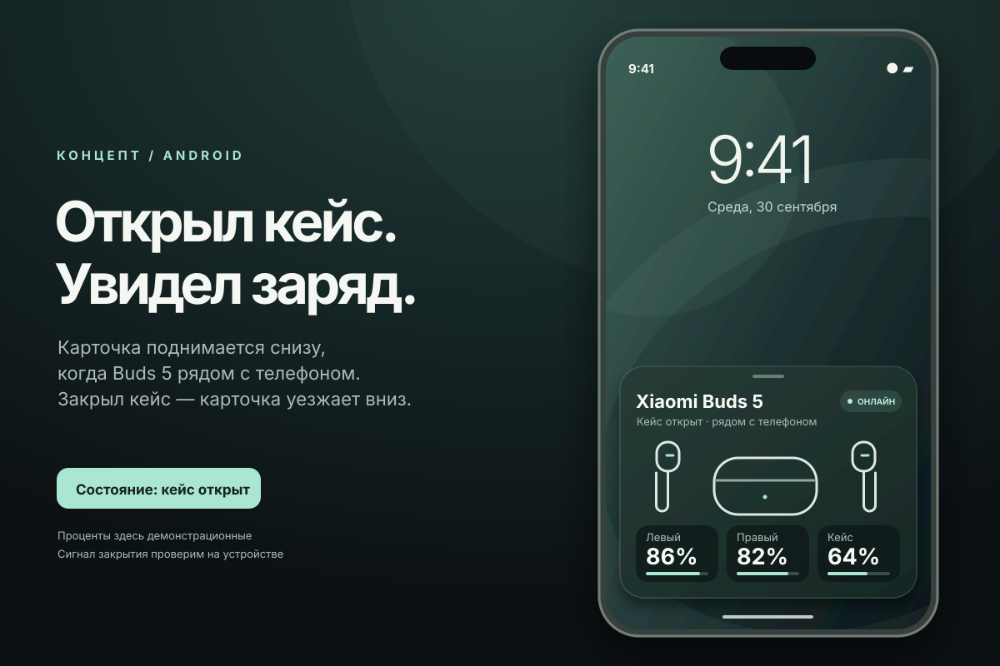

# Buds Curtain

**Заряд Xiaomi Buds 5 — в карточке поверх текущего экрана.** Приложение наблюдает Bluetooth-сигналы наушников, показывает заряд левого наушника, кейса и правого наушника и скрывает карточку при изменении состояния.

**Android 12+ · версия 0.6.6 · тестовая сборка для Xiaomi Buds 5**

[**Скачать APK**](https://github.com/cveloy102/buds-curtain/releases/download/v0.6.6/BudsCurtain-poco-f7-test.apk) · [Релиз 0.6.6](https://github.com/cveloy102/buds-curtain/releases/tag/v0.6.6) · [История версий](CHANGELOG.md) · [Сборка](docs/DEVELOPMENT.md)

## Карточка наушников

Макет карточки, а не снимок установленного приложения. Текущая сборка поддерживает светлую, тёмную и системную темы; проверенный порядок заряда — **левый → кейс → правый**.

## Возможности

- Автоматическое обнаружение единственных сопряжённых Xiaomi Buds 5 или ручной выбор устройства.
- Отображение трёх значений заряда по свежим Fast Pair-сигналам.
- Показ, когда получено подтверждение обоих наушников в кейсе; скрытие при извлечении, закрытии, потере сигнала или отключении Bluetooth.
- Карточка следует за пальцем: короткий свайп возвращает её, длинный скрывает до следующего открытия.
- Светлая, тёмная и системная темы для экрана приложения и карточки.
- Фоновое наблюдение, восстановление BLE-сканирования и локальная диагностика.
- Демонстрационный показ карточки для проверки внешнего вида.

Если свежих данных нет, вместо заряда отображается `—`. Демонстрационные значения явно отмечены как пример.

## Начало работы

1. Установите APK из релиза. Для приватного репозитория требуется вход в GitHub с доступом.
2. Выдайте разрешения **Устройства поблизости** и **Показ поверх других приложений**.
3. Выберите сопряжённые Xiaomi Buds 5 и нажмите **Запустить наблюдение**.
4. При включённом экране откройте кейс с обоими наушниками внутри.
5. Выберите тему и при необходимости разрешите автозапуск в настройках HyperOS.

## Как определяется состояние

Карточка использует рекламные Bluetooth-пакеты, а не отдельный датчик крышки. Подтверждения левого и правого наушника объединяются в пределах шести секунд. Известный заряд кейса и признаки зарядки обоих наушников помогают исключить повторные показы при использовании одного наушника.

## Совместимость и данные

Проверено на **Xiaomi Buds 5 + POCO F7, Android 16 / HyperOS 3**. Поддержка других моделей наушников не заявлена. На заблокированном экране новое окно не показывается. Задержка зависит от поступления BLE-сигналов; энергосбережение может ограничивать фоновое наблюдение.

Данные обрабатываются локально. Расширенный журнал содержит Bluetooth-адреса; включайте его для диагностики и проверяйте перед передачей. Наблюдение можно остановить в приложении.

## В версии 0.6.6

- Увеличено окно объединения раздельных сигналов до шести секунд.
- Добавлено видимое состояние восстановления Bluetooth.
- Сохранены фильтрация ложных показов и удаление overlay после скрытия.

Подробнее: [CHANGELOG](CHANGELOG.md). Результаты проверок: [OBSERVATIONS](OBSERVATIONS.md).
