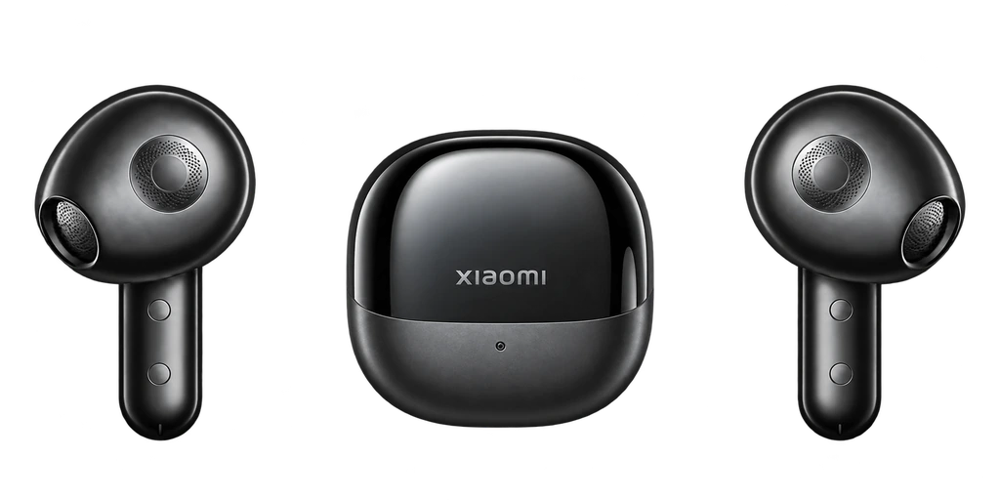

# Xiaomi Buds 5 Overlay

### Открыл кейс. Увидел заряд.

Неофициальное Android-приложение для Xiaomi Buds 5.

**Android 12+ · тестовая версия 0.6.8**

[**Сайт**](https://cveloy102.github.io/buds-curtain/) · [**Скачать APK**](https://github.com/cveloy102/buds-curtain/releases/tag/v0.6.8) · [**Инструкция**](docs/usage.md) · [**История версий**](CHANGELOG.md)

*Рендер Buds 5 Graphite Black, используемый в приложении. На сайте — светлая и тёмная карточки из дизайн-стенда.*

**Заряд Xiaomi Buds 5 — в карточке поверх текущего экрана.** Приложение наблюдает Bluetooth-сигналы наушников, показывает заряд левого наушника, кейса и правого наушника и скрывает карточку при изменении состояния.

[Скачать APK 0.6.8](https://github.com/cveloy102/buds-curtain/releases/download/v0.6.8/XiaomiBuds5Overlay-0.6.8.apk) · [Инструкция и FAQ](docs/usage.md) · [Данные и разрешения](docs/PRIVACY.md) · [Сборка](docs/DEVELOPMENT.md)

## Карточка наушников

На [сайте проекта](https://cveloy102.github.io/buds-curtain/#preview) можно посмотреть скриншоты тёмной и светлой карточки из дизайн-стенда. Значения заряда на стенде даны для примера. В приложении доступны светлая, тёмная и системная темы; проверенный порядок заряда — **левый → кейс → правый**.

## Возможности

- Автоматическое обнаружение единственных сопряжённых Xiaomi Buds 5 или ручной выбор устройства.
- Отображение трёх значений заряда по свежим Fast Pair-сигналам.
- Показ, когда получено подтверждение обоих наушников в кейсе; скрытие при извлечении, закрытии, потере сигнала или отключении Bluetooth.
- Карточка следует за пальцем: короткий свайп возвращает её, длинный скрывает до следующего открытия.
- Светлая, тёмная и системная темы для экрана приложения и карточки.
- Фоновое наблюдение, восстановление BLE-сканирования и локальная диагностика.
- Демонстрационный показ карточки для проверки внешнего вида.

Если свежих данных нет, вместо заряда отображается `—`. Демонстрационные значения явно отмечены как пример.

## Начало работы

1. Установите APK из [релиза 0.6.8](https://github.com/cveloy102/buds-curtain/releases/tag/v0.6.8).
2. Выдайте разрешения **Устройства поблизости** и **Показ поверх других приложений**.
3. Выберите сопряжённые Xiaomi Buds 5 и нажмите **Запустить наблюдение**.
4. При включённом экране откройте кейс с обоими наушниками внутри.
5. Выберите тему и при необходимости разрешите автозапуск в настройках HyperOS.

[Пошаговая инструкция и решение проблем →](docs/usage.md)

## Как определяется состояние

Карточка использует рекламные Bluetooth-пакеты, а не отдельный датчик крышки. Подтверждения левого и правого наушника объединяются в пределах шести секунд. Известный заряд кейса и признаки зарядки обоих наушников помогают исключить повторные показы при использовании одного наушника.

## Совместимость и данные

Проверено на **Xiaomi Buds 5 + POCO F7, Android 16 / HyperOS 3**. Поддержка других моделей наушников не заявлена. На заблокированном экране новое окно не показывается. Задержка зависит от поступления BLE-сигналов; энергосбережение может ограничивать фоновое наблюдение.

Данные обрабатываются локально. Расширенный журнал содержит Bluetooth-адреса; включайте его для диагностики и проверяйте перед передачей. Наблюдение можно остановить в приложении. Подробнее: [данные и разрешения](docs/PRIVACY.md).

Для разработчиков: [сборка и выпуск](docs/DEVELOPMENT.md) · [участие в проекте](CONTRIBUTING.md) · [безопасность](SECURITY.md).

## В версии 0.6.8

- Сканирование восстанавливается после выключения и включения Bluetooth.
- При открытии приложения после потери сигналов регистрация сканера обновляется без принудительного завершения процесса.
- Отсутствие рекламы закрытого кейса не вызывает перезапуски сканера в фоне.
- Запуск при выключенном Bluetooth оставляет наблюдение ждать включения адаптера.
- Проверка дизайна сохраняет автоматическое восстановление работающей службы.
- Сохранены экономный режим, фильтрация ложных показов и удаление overlay после скрытия.

Подробнее: [CHANGELOG](CHANGELOG.md). Результаты проверок: [OBSERVATIONS](OBSERVATIONS.md).
